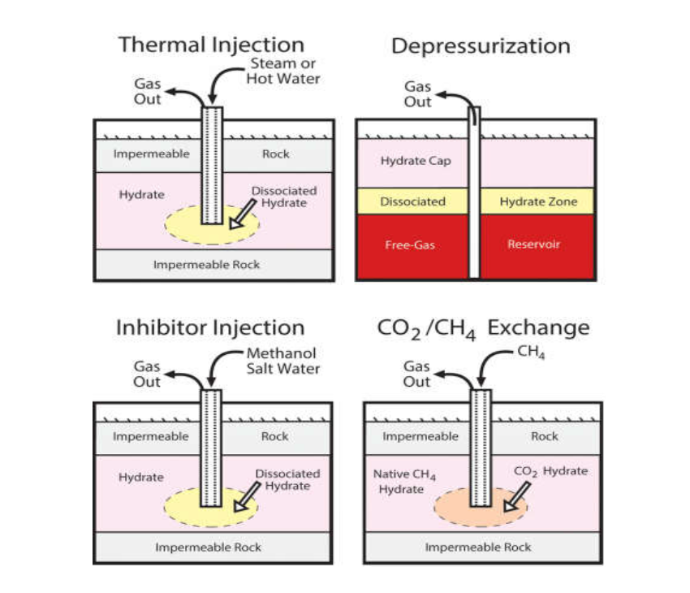

# Posible Problemática Ambiental Ligada a la Explotación de Hidratos de Metano.

 

## Universidad de Cádiz
### Facultad de Ciencias del Mar y Ambientales

 

#### Asignatura: Oceanografía Geológica Aplicada.

**Profesora:** Elizabeth Blázquez Gómez 

 

**Autor:** Christian Dibari  
**Curso:** 2026–2027

   

Puerto Real, Cádiz  
Octubre 2026

### Índice de Contenidos

1. Introducción: los hidratos de metano.
2. Principales Técnicas de Explotación.
3. Posible problemática ambiental asociada a la explotación de hidratos de metano

### Introducción los hidratos de metano

Los hidratos de metano son sólidos cristalinos $^1$, similares al hielo (también es un s.c.), formados por moléculas de agua que crean estructuras capaces de atrapar moléculas de metano $^2$. (Ruppel, 2018; Boswell et al., 2020).

Se forman bajo condiciones específicas de baja temperatura y alta presión, denominadas termodinámicamente la Zona de Estabilidad del Hidrato (ZEH) (Ruppel, 2018).
Como se puede visualizar en la figura, esta ventana de estabilidad se localiza principalmente en dos entornos geológicos globales: los sedimentos marinos de los márgenes continentales (donde la columna de agua profunda aporta la presión hidrostática necesaria y temperaturas inferiores a los 4 °C) y en las regiones subárticas de permafrost, donde el suelo permanentemente congelado a cientos de metros de profundidad actúa como una barrera térmica que estabiliza el clatrato incluso a presiones litostáticas moderadas. Como ejemplos clave de la primera localización se destacan los yacimientos confirmados en rojo del Golfo de México y la fosa de Nankai en Japón, mientras que para el segundo caso se tienen los depósitos de la vertiente norte de Alaska y el delta del río Mackenzie en Canadá (Boswell et al., 2020; Waite et al., 2020).

Su interés práctico y estratégico radica en su extraordinaria densidad energética volumétrica $^3$: un solo metro cúbico de hidrato sólido libera, mediante disociación térmica o descompresión $^4$, aproximadamente 164 metros cúbicos de gas metano en condiciones normales de presión y temperatura (CNPT: 1 atm, 0 °C).
Dicho aspecto convierte a estos depósitos en un recurso energético no convencional cuyo volumen de carbono orgánico estimado podría duplicar el de todos los combustibles fósiles tradicionales combinados (carbón, petróleo y gas convencional).
Sin embargo, la abundancia en términos de recurso geológico bruto no equivale a una reserva comercialmente explotable: la viabilidad técnica de su extracción masiva sigue limitada por la baja permeabilidad de las matrices sedimentarias finas $^5$ y la ausencia de tecnologías de producción estables y económicamente rentables (Boswell et al., 2020).

Por ello, aunque representan un recurso energético con un potencial revolucionario, su explotación plantea una cuestión fundamental: ¿hasta qué punto podemos extraer el metano sin desestabilizar los sedimentos marinos ni provocar emisiones adicionales de gases de efecto invernadero?

*Distribución mundial de hidratos de gas conocidos e inferidos. USGS (Waite et al., 2020) | sciencebase.gov*

Hidratos Conocidos (Puntos Rojos / Known Hydrate): Representan los enclaves geográficos de máxima certidumbre. El símbolo denota sitios donde la existencia de hidratos ha sido ratificada mediante verificación física directa, ya sea por la recuperación mecánica de muestras sólidas en sondeos y testigos de perforación profunda, o por documentación videográfica in situ realizada por vehículos submarinos operados remotamente (ROV) en el fondo marino (Collett et al., 2019; Waite et al., 2020). Visualmente, estos puntos se concentran en provincias con alta intensidad de exploración geológica, como el Golfo de México, el margen de Japón (fosa de Nankai) y el norte de Alaska.

Hidratos Inferidos por Otros Indicadores (Puntos Amarillos / Inferred Hydrate - indicators other than just bottom simulating reflections): Clasifica las regiones donde la presencia del compuesto se deduce mediante anomalías geológicas, térmicas o geoquímicas indirectas de los sedimentos. Dichas evidencias incluyen la detección de plumas de gas metano exhaladas desde el lecho oceánico, anomalías de enfriamiento en núcleos de sedimentos o variaciones anómalas (clorinidad decreciente o desalinización) en el agua intersticial recuperada durante expediciones oceanográficas (Ruppel y Kessler, 2017).

Hidratos Inferidos por Reflectores Sísmicos (Asteriscos Azules / Inferred Hydrate - only bottom simulating reflections): Indica localizaciones identificadas exclusivamente mediante técnicas geofísicas de reflexión sísmica. El marcador señala la presencia inequívoca del BSR (Bottom Simulating Reflector), una traza o reflector acústico anómalo que corre paralelo a la topografía del fondo del mar y que subraya el límite basal de la zona de estabilidad térmica del hidrato, separando mecánicamente los sedimentos densos cementados por clatrato sólido de las capas inferiores saturadas de metano en fase gaseosa libre (Kvenvolden, 1993; Waite et al., 2020).

La imagen ilustra que los hidratos no se sitúan en las extensas cuencas o llanuras abisales centrales del Océano Pacífico, Atlántico o Índico, sino que se concentran en las pendientes de los márgenes continentales (zona de talud y emersión continental).

Se observa una densa franja continua de asteriscos azules e hidratos conocidos a lo largo de todo el margen occidental de América (desde Alaska hasta la Patagonia) y el margen oriental de Asia. Esta disposición coincide visualmente con las zonas de subducción y fallas activas del Cinturón de Fuego del Pacífico, donde el flujo de fluidos tectónicos canaliza la acumulación de metano (Waite et al., 2020).

En el extremo septentrional de la imagen (márgenes del Océano Ártico, norte de Alaska, Canadá y Siberia), los puntos rojos y amarillos se adentran en zonas emergidas continentales. Gráficamente, esto delimita la distribución de los hidratos asociados a las gruesas capas del permafrost ártico circumpolar, el cual actúa como trampa geológica y térmica para la estabilización del gas a profundidades someras (Collett et al., 2019; Ruppel y Kessler, 2017).

---

1. **Sólidos cristalinos:** material en el que sus átomos, iones o moléculas se ordenan de forma regular y periódica repitiéndose en las tres dimensiones del espacio, lo que da lugar a una estructura interna fija llamada red cristalina.
2. **Atrapar moléculas de metano:** Los hidratos de metano son clatratos (compuestos de inclusión) donde el agua (anfitrión) forma una red cristalina de poliedros huecos mediante puentes de hidrógeno, confinando físicamente al metano (huésped) sin enlaces químicos. La inclusión ocurre por la nucleación del cristal a alta presión y baja temperatura, donde el metano queda atrapado por impedimento estérico (restricción del movimiento de una molécula debido al espacio físico que ocupan los átomos circundantes), ya que su tamaño le permite estabilizar la cavidad mediante fuerzas de Van der Waals (atracciones electrostáticas débiles entre moléculas no polares) pero le impide escapar por los poros de la jaula. Ante cualquier intento de fuga, la repulsión electrónica de Pauli (fuerza cuántica que impide que dos electrones ocupen el mismo espacio, haciendo que las nubes electrónicas se repelan al acercarse) devuelve al gas al centro del cristal, estabilizando el sistema.
3. **Densidad energética volumétrica:** Cantidad de energía (o gas combustible) almacenada por unidad de volumen de material (elevadísima en HM ya que el gas está comprimido).
4. **Disociación térmica o descompresión:** Disociación = romper la estructura del clatrato. Se logra inyectándole calor (disociación térmica) o bajando la presión del pozo (descompresión) para que el hielo se vuelva inestable y libere el metano. La descompresión se logra bombeando hacia la superficie el agua y los fluidos acumulados dentro del pozo para reducir la presión hidrostática circundante, forzando el hielo a disociarse.
5. **Permeabilidad de las matrices sedimentarias finas:** Los hidratos suelen estar mezclados con el barro y la arena del fondo del mar (la matriz sedimentaria). Si el sedimento es arcilloso o muy fino, tiene baja permeabilidad, lo que significa que el metano disociado no puede fluir hacia las tuberías de extracción porque los poros del suelo están bloqueados.

---

### Principales Técnicas de Explotación

Actualmente, la **despresurización** constituye la estrategia de explotación predominante debido a su simplicidad operativa y viabilidad económica, fundamentándose en la reducción de la presión del yacimiento para inducir la disociación química del clatrato (Zhu et al., 2025). Sin embargo, su principal limitación es el bloqueo endotérmico; la disociación absorbe una cantidad masiva de energía térmica del entorno, provocando una caída drástica de la temperatura interna que congela el agua liberada in situ o estimula la reformación de hidratos secundarios, taponando por completo la permeabilidad del yacimiento y deteniendo el flujo espontáneamente (Wang et al., 2025).

Por su parte, la **estimulación térmica** logra el mismo objetivo mediante el aporte exógeno de calor; al superar el umbral de la temperatura de equilibrio de fase del sistema, se desencadena la liberación del gas (Zhu et al., 2025). El gran inconveniente de este método es su balance energético negativo; la disipación térmica y las pérdidas de calor en el trayecto hacia aguas profundas demandan más energía de la que produce el gas metano finalmente recuperado (Wang et al., 2025).

Como alternativa molecular, la **sustitución por dióxido de carbono** ($CO_2$) aprovecha la mayor afinidad termodinámica de este compuesto para estructurar clatratos, reemplazando el metano alojado en las cavidades y ofreciendo un beneficio simultáneo de almacenamiento de carbono. Su aplicación a escala de campo se descarta comercialmente debido a los altísimos costos de los reactivos químicos (Wang et al., 2025). 

En contraste, la **inyección de inhibidores químicos** (tales como metanol, soluciones salinas o etanol) altera la curva de estabilidad de fases para forzar la disociación, aunque se cataloga como una técnica ineficiente, de alto costo operativo y con un impacto ambiental desfavorable. Su barrera crítica radica en una cinética de intercambio extremadamente lenta, cuya baja velocidad de difusión molecular imposibilita el abastecimiento de un flujo comercial competitivo (Wang et al., 2025).

Debido a las limitaciones individuales de cada técnica, la tendencia científica actual apunta hacia la implementación de métodos combinados o sinérgicos como la ruta más eficiente para la recuperación a escala comercial de estos recursos de gas (Zhu et al., 2025). 

En la actualidad, no existe una explotación comercial a gran escala o industrial de los hidratos de gas metano en ninguna región del mundo; la industria energética global se encuentra firmemente anclada en una fase de investigación avanzada y pruebas piloto de corta duración (Methane Hydrate Production Feasibility | Department of Energy).
A pesar de que se han completado con éxito pruebas de producción controladas en el permafrost de Alaska y en el talud continental marino del Mar de China Meridional y la fosa de Nankai, estas operaciones se ven severamente limitadas a escalas de semanas o meses debido a que las tecnologías actuales son incapaces de mantener un flujo de gas económicamente rentable y constante en el tiempo (Collett, 2019; U.S. Geological Survey, 2024).

*Principales métodos de explotación y extracción de hidratos de gas. Fuente: Zhu et al. (2025) | preprints.org.*

La recuperación de hidratos de gas introduce un peligro crítico de deflagración debido a la inestabilidad termodinámica del metano durante su transición de fase. Al disociarse de la matriz clatrata sólida, el gas experimenta una expansión volumétrica violenta que incrementa hasta 164 veces su volumen original, generando presiones hidromecánicas extremas que pueden fracturar el pozo y provocar brotes descontrolados de fluidos (well blowouts) en la infraestructura de perforación (Wang et al., 2025). Asimismo, las fluctuaciones térmicas dentro de las líneas de producción propician el auto-bloqueo por congelamiento; si estos tapones secundarios se despresurizan de forma incorrecta, la acumulación de energía cinética remanente causa fallas mecánicas destructivas en las tuberías de transporte (Liu et al., 2026). Finalmente, las fugas de gas hacia la superficie que interactúan con el oxígeno ambiental generan mezclas gaseosas inflamables dentro de los límites de explosividad, donde cualquier arco eléctrico o fricción mecánica desencadena la combustión del complejo industrial (Ruppel & Kessler, 2017).

### Posible problemática ambiental asociada a la explotación de hidratos de metano

La extracción de hidratos de metano puede generar impactos ambientales porque requiere modificar las condiciones de presión y temperatura del yacimiento para liberar el gas. Los principales riesgos se relacionan con las emisiones de metano, la estabilidad del fondo marino y los cambios en los ecosistemas y la química del agua.

**En primer lugar, las emisiones de metano y el cambio climático.** Durante la extracción, una parte del gas podría escapar a través del pozo, de fracturas o de vías de migración presentes en los sedimentos. El metano tiene un potencial de calentamiento superior al del $CO_2$ por unidad de masa, especialmente si se considera un horizonte temporal corto. Sin embargo, es importante distinguir entre liberar metano en el fondo marino y emitirlo a la atmósfera: una parte puede disolverse en el agua y ser oxidada por microorganismos antes de llegar a la superficie. Por tanto, el impacto climático dependerá de la cantidad de gas liberada, de la profundidad y de la eficiencia de los mecanismos naturales que lo retienen o transforman (Ruppel & Kessler, 2017).

**En segundo lugar, la inestabilidad del fondo marino.** Los hidratos pueden contribuir a dar resistencia a los sedimentos donde se encuentran. Al descomponerse, esa contribución mecánica disminuye y, junto con los cambios de presión y la generación de gas y fluidos, puede producirse deformación del terreno, compactación, subsidencia o inestabilidad de taludes. También pueden aparecer problemas de producción, como la entrada de arena en los pozos o la creación de nuevas vías de fuga. Estos procesos podrían comprometer las instalaciones y alterar el hábitat del fondo marino. No significa que cada extracción vaya a provocar un deslizamiento: el riesgo depende de la geología, la profundidad, las características del sedimento y el control del proceso (Geomechanical issues in the exploitation of natural gas hydrate, 2020; Yamamoto et al., 2022).

**En tercer lugar, los efectos sobre los ecosistemas bentónicos.** La perforación, la deposición o resuspensión de sedimentos y los cambios en el flujo de metano pueden perturbar las comunidades que viven en el fondo marino. Esto es especialmente relevante en los llamados *cold seeps*, zonas donde los fluidos y gases ascienden de forma natural y mantienen comunidades microbianas y organismos adaptados a esas condiciones. Estas comunidades no son simplemente víctimas de la presencia de metano: también participan en su transformación y en el ciclo del carbono. Una perturbación intensa o prolongada podría modificar el equilibrio de estos hábitats y sus comunidades.

**En cuarto lugar, los cambios en la química del agua.** Cuando el metano se oxida, los microorganismos consumen oxígeno y producen carbono inorgánico disuelto, incluido CO₂. Si el proceso es suficientemente intenso y localmente concentrado, puede reducir el oxígeno disponible y modificar el equilibrio químico del agua, contribuyendo a la acidificación local. La importancia de este efecto dependerá del volumen de metano, de la circulación y renovación del agua y de la actividad microbiana; no debe suponerse que cualquier fuga provocará una acidificación generalizada del océano (Liu et al., 2019; Ruffine et al., 2023).

**Por último, existe una dificultad transversal: la detección y el seguimiento de los impactos.** Una fuga puede ser intermitente, desplazarse por fracturas o producirse lejos del pozo. Por eso no basta con medir únicamente el gas extraído: es necesario vigilar también la columna de agua, la química de los sedimentos, la estabilidad del fondo marino y las comunidades biológicas. Los estudios de seguimiento antes, durante y después de las pruebas son fundamentales para diferenciar la variabilidad natural de los cambios asociados a la explotación (Liu et al., 2019).

En conclusión, la principal preocupación no es que estos impactos vayan a ocurrir necesariamente, sino que la extracción puede alterar simultáneamente el ciclo del metano, la estabilidad del sedimento y los ecosistemas del fondo marino. Como todavía no existe una explotación comercial marina a gran escala que permita evaluar todos estos efectos durante periodos prolongados, la monitorización y la evaluación ambiental son esenciales antes de ampliar esta actividad.

*Esquema de las fuentes y los sumideros de metano asociados a la descomposición de hidratos. Fuente: Ruppel y Kessler (2017).*

El esquema representa las distintas fuentes y los mecanismos que controlan el destino del metano en el sistema océano-atmósfera. Para interpretarlo, conviene seguir el recorrido del gas desde su liberación en los sedimentos marinos hasta su posible llegada a la atmósfera.
En primer lugar, el metano puede liberarse cuando los hidratos se descomponen y el gas asciende desde los sedimentos hacia el fondo marino. A partir de ahí, una parte puede escapar en forma de burbujas. Mientras estas ascienden por la columna de agua, el metano puede pasar al agua circundante por disolución. Esto significa que el gas liberado en el fondo no llega necesariamente a la superficie.
En segundo lugar, el metano disuelto puede ser consumido por microorganismos mediante la oxidación microbiana. En presencia de oxígeno, este proceso consume oxígeno y transforma el metano principalmente en dióxido de carbono. También existen mecanismos físicos y químicos que retienen o transforman parte del gas en los sedimentos y el océano. La eficacia de estos procesos depende, entre otros factores, de la profundidad, las corrientes, las concentraciones de metano y la actividad microbiana.
Por último, solo la fracción que logra llegar a la superficie y transferirse a la atmósfera puede contribuir directamente al efecto invernadero atmosférico como metano. Por eso, la figura no debe interpretarse como una demostración de que los hidratos están provocando grandes emisiones atmosféricas, sino como una representación del balance entre las fuentes de metano y los procesos que limitan su propagación.

*Resumen gráfico de los métodos de monitorización de los impactos ambientales asociados a los hidratos de gas marinos. Fuente: Liu et al. (2019).*

La imagen representa un sistema de explotación de hidratos de gas marinos equipado con pozos de producción y de monitorización ambiental, cuyo objetivo es extraer el gas y controlar los posibles efectos de la operación sobre los sedimentos y el medio marino.
El pozo central (Production Well) atraviesa los sedimentos hasta alcanzar la zona de hidratos de metano (MH Zone), situada en el esquema a unos 300 m bajo el fondo marino y con un espesor aproximado de 50 m. Mediante el pozo se extrae el gas liberado del yacimiento. A ambos lados se sitúan dos pozos de monitorización (Monitoring Wells), separados aproximadamente 25 m del pozo de producción, que permiten observar cambios en el subsuelo durante la explotación. Estos cambios pueden incluir variaciones de presión y temperatura, migración de gas o alteraciones de las propiedades de los sedimentos.
Los sistemas de monitorización instalados en el fondo marino registran señales físicas, químicas y geológicas. Los datos se transmiten mediante un cable submarino de telemetría y alimentación eléctrica hasta el buque, que también puede utilizar técnicas acústicas para observar la columna de agua. Además, un vehículo operado remotamente (ROV) permite inspeccionar visualmente el entorno y detectar posibles anomalías.
La importancia de este diseño es que no se limita a medir cuánto gas se extrae: también permite vigilar si la explotación modifica el entorno. La detección temprana de fugas, cambios en los sedimentos o señales de inestabilidad ayuda a evaluar los riesgos y a decidir si es necesario modificar o detener las operaciones. Liu et al. (2019) destacan precisamente la necesidad de integrar distintas técnicas de monitorización para evaluar los posibles impactos ambientales de la explotación de hidratos marinos.

### Fuentes Consultadas (Bibliografía y Webgrafía)

Boswell, R., Hancock, S., Yamamoto, K., Collett, T. S., Pratap, M., & Lee, S.-R. (2020). Natural gas hydrates: Status of potential as an energy resource. En Future energy (3.ª ed., pp. 111–131). Elsevier. https://doi.org/10.1016/B978-0-08-102886-5.00006-2

Collett, T. S. (2019). Gas hydrate production testing—Knowledge gained. Offshore Technology Conference. https://doi.org/10.4043/29516-MS

Geomechanical issues in the exploitation of natural gas hydrate. (2020). Gondwana Research, 81, 403–422. https://doi.org/10.1016/j.gr.2019.11.014

Liu, L., Ryu, B., Sun, Z., Wu, N., Cao, H., Geng, W., Zhang, X., Jia, Y., Xu, C., Guo, L., & Wang, L. (2019). Monitoring and research on environmental impacts related to marine natural gas hydrates: Review and future perspective. Journal of Natural Gas Science and Engineering, 65, 82–107. https://doi.org/10.1016/j.jngse.2019.02.007

Ruffine, L., Tang, A. M., O’Neill, N., Toffin, L., Paris, J.-D., Yang, J., Georgiev, V., Fietzek, P., Giustiniani, M., & Tinivella, U. (2023). Environmental challenges related to methane hydrate decomposition from climate change scenario and anthropic activities: State of the art, potential consequences and monitoring solutions. Earth-Science Reviews, 246, Article 104578. https://doi.org/10.1016/j.earscirev.2023.104578

Ruppel, C. D. (2018). Gas hydrate in nature (Fact Sheet 2017–3080). U.S. Geological Survey. https://doi.org/10.3133/fs20173080

Ruppel, C. D., & Kessler, J. D. (2017). The interaction of climate change and methane hydrates. Reviews of Geophysics, 55(1), 126–168. https://doi.org/10.1002/2016RG000534

Ruppel, C. D., & Waite, W. F. (2020). Timescales and processes of methane hydrate formation and breakdown, with application to geologic systems. Journal of Geophysical Research: Solid Earth, 125(8), e2018JB016459. https://doi.org/10.1029/2018JB016459

U.S. Geological Survey. (2024). Gas hydrate energy research—2024 update. https://www.usgs.gov/centers/central-energy-resources-science-center/science/gas-hydrate-energy-research-2024-update

Waite, W. F., Ruppel, C. D., Boze, L.-G., Lorenson, T. D., Buczkowski, B. J., McMullen, K. Y., & Kvenvolden, K. A. (2020). Preliminary global database of known and inferred gas hydrate locations [Conjunto de datos]. U.S. Geological Survey data release. https://doi.org/10.5066/P9llFVJM

Wang, X., Zhang, L., & Liu, Y. (2025). Natural gas hydrate exploitation: A comprehensive review of structural properties, technical progress and environmental challenges. Journal of Energy Storage, 92, 108-124.

Zhu, M., Zhang, H., Shi, Y., Zhou, J., & Fu, L. (2025). Changes of heat and energy during depressurization-induced natural gas hydrate dissociation in porous media. Preprints.org. https://doi.org

